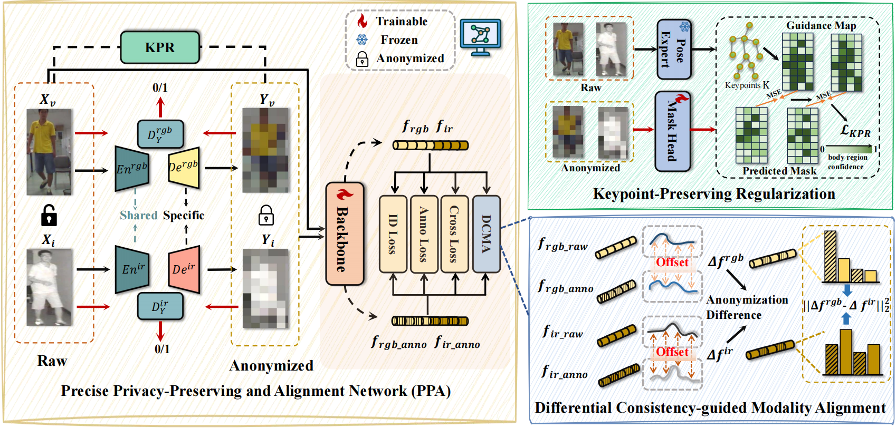

# Towards Cross-Modal Preservation, Consistency and Alignment for Privacy-Preserving Visible-Infrared Person Re-Identification


## Abstract

Privacy-preserving Person Re-Identification (PP-ReID) addresses the core privacy-utility trade-off in Re-ID by retrieving a person across multiple non-overlapping cameras
while applying anonymization techniques to protect sensitive information. However, prior PP-ReID studies are
confined to single-modality visible scenarios, as 24-hour
surveillance systems require robust cross-modal visibleinfrared (VI) capabilities. Extending PP-ReID to the crossmodal VI setting is therefore crucial. Accordingly, we introduce a new task: Privacy-Preserving Visible-Infrared Person Re-Identification (PP-VI-ReID). This task presents two
severe challenges: 1) Crude anonymization strategies destroy identity-critical information and disrupt cross-modal
alignment 2) The anonymization process creates inconsistent distortions across modalities. It disrupts color-based
textures in visible images while obscuring thermal contours in infrared images. This inconsistency with modality gap forms a Mixed Gap. To overcome these challenges, we propose a framework, the Precise Privacy-preserving and Alignment Network (PPA) with two components: 1) A Keypoint-Preserving Regularization (KPR)
module leverages human pose as a prior to guide structure-aware anonymization, preserving essential body features.
2) A Differential Consistency-guided Modality Alignment
(DCMA) treats anonymization perturbations not as varying
noise, but as a stable, learnable offset, facilitating robust
alignment between raw and anonymized features across
modalities. Experiments on SYSU-MM01 and RegDB validate our framework, establishing a strong baseline.

## Framework

<div align="center">
  
</div>

---

### Environment


```bash
conda create -n ppa python=3.8
conda activate ppa
pip install -r requirements.txt
```


### Datasets


- (1) RegDB Dataset [3]: The RegDB dataset can be downloaded from this [website](http://dm.dongguk.edu/link.html) by submitting a copyright form.

    - (Named: "Dongguk Body-based Person Recognition Database (DBPerson-Recog-DB1)" on their website). 
  
- (2) SYSU-MM01 Dataset [4]: The SYSU-MM01 dataset can be downloaded from this [website](http://isee.sysu.edu.cn/project/RGBIRReID.htm).

   - run `python pre_process_sysu.py` to pepare the dataset, the training data will be stored in ".npy" format.


### Teacher Checkpoint

This project also uses a teacher model. Please define `cfg.PRETRAINED_TEACHER` in `config/configs.py` as the folder that stores teacher checkpoints:

```python
cfg.PRETRAINED_TEACHER = './pretrained'
```

Prepare teacher parameter files in this folder:

```text
pretrained/
├── teacher_model_sysu.t
└── teacher_model_regdb.t
```

The code automatically selects the teacher checkpoint by dataset name:

- `DATASETS.NAMES == 'sysu'` -> `teacher_model_sysu.t`
- `DATASETS.NAMES == 'regdb'` -> `teacher_model_regdb.t`

You can download the teacher checkpoints from [Google Drive](https://drive.google.com/drive/folders/1-LJ5aVEbAMfSgDhE5fpL5rjJePN1y8Io?usp=drive_link). After downloading, place the checkpoint files in the directory specified by `cfg.PRETRAINED_TEACHER`.


### train


```bash
python main.py MODEL.DEVICE "cuda:7" MODEL.DEVICE_ID "('7')" DATASETS.ROOT_DIR "/data0/yb_data/sysu/" DATASETS.NAMES "('sysu')" INPUT.TYPE "mosaic" INPUT.RADIUS "24.0" OUTPUT_DIR "('/data1/yb_log/csreid/sysu/sysu-mosaic-full')" MODEL.VAL_R1 "0.15" MODEL.DCMA "on" MODEL.DCMA_LAMBDA "0.1" MODEL.POSE_GUIDE "on" MODEL.POSE_LAMBDA "1.0"
```

```bash
python main.py MODEL.DEVICE "cuda:4" MODEL.DEVICE_ID "('4')" DATASETS.ROOT_DIR "/data0/yb_data/sysu/" DATASETS.NAMES "('sysu')" INPUT.TYPE "noise" INPUT.RADIUS "0.5" OUTPUT_DIR "('/data1/yb_log/csreid/sysu/sysu-noise-full')" MODEL.VAL_R1 "0.15" MODEL.DCMA "on" MODEL.DCMA_LAMBDA "0.1" MODEL.POSE_GUIDE "on" MODEL.POSE_LAMBDA "1.0"
```

```bash
python main.py MODEL.DEVICE "cuda:7" MODEL.DEVICE_ID "('7')" DATASETS.ROOT_DIR "/data0/yb_data/sysu/" DATASETS.NAMES "('sysu')" INPUT.TYPE "blur" INPUT.RADIUS "12.0" OUTPUT_DIR "('/data1/yb_log/csreid/sysu/sysu-blur-full')" MODEL.VAL_R1 "0.15" MODEL.DCMA "on" MODEL.DCMA_LAMBDA "0.1" MODEL.POSE_GUIDE "on" MODEL.POSE_LAMBDA "1.0"
```

### Test

```bash
python test.py \
  INPUT.TYPE "mosaic" \
  INPUT.RADIUS "24.0" \
  OUTPUT_DIR "./log/sysu/test/sysu-mosaic-test" \
  TEST.EVALUATE_ONLY "('on')" \
  MODEL.PRETRAIN_CHOICE "('self')" \
  MODEL.PRETRAIN_DIR "./log/sysu/sysu-mosaic"
```


```bash
python testreg.py \
  DATASETS.ROOT_DIR "data/regdb/" \
  DATASETS.NAMES "('regdb')" \
  INPUT.TYPE "mosaic" \
  INPUT.RADIUS "24.0" \
  OUTPUT_DIR "./log/regdb/test/regdb-mosaic-test" \
  TEST.EVALUATE_ONLY "('on')" \
  MODEL.PRETRAIN_CHOICE "('self')" \
  MODEL.PRETRAIN_DIR "./log/regdb/regdb-mosaic"
```


## output


```
OUTPUT_DIR/
├── events.out.tfevents.xxx  # TensorBoard
├── epoch_best_net_C.pth     # reid_network
├── epoch_best_net_G.pth     # generator
├── epoch_best_net_D1.pth    
└── log.txt                  # log
```


## Contact

x2471722964@outlook.com


